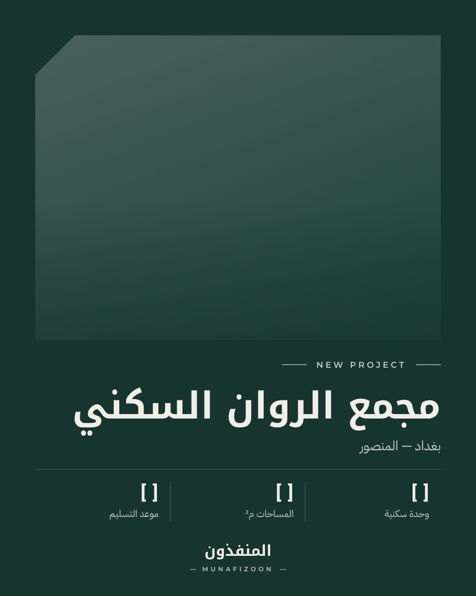
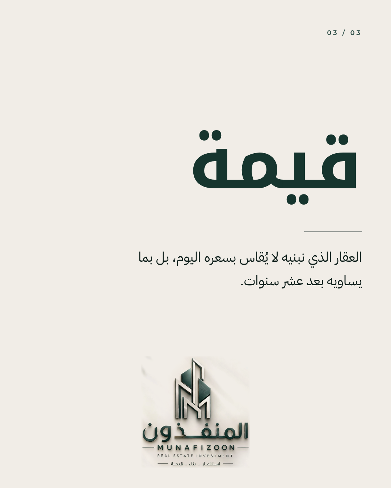
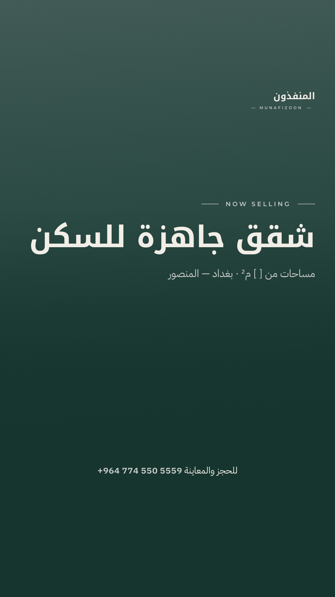

# المنفذون — مهارة تصميم السوشيال ميديا

مهارة لـ **Claude Code** تصمم بوستات وستوريات إنستغرام لهوية **«المنفذون — استثمار عقاري»** (MUNAFIZOON Real Estate Investment) بألوانها: زمردي عميق، فضي مصقول، عاجي دافئ.

| بوست إطلاق مشروع | بوست قيمة العلامة | ستوري إعلان |
|---|---|---|
|  |  |  |

## ماذا تفعل

- تصمم بوستات 4:5 ومربعة وستوريات 9:16 وكاروسيل وأغلفة ريلز
- تكتب برومتات توليد صور بهوية الشركة (Midjourney، GPT Image، Gemini، Flux)
- تكتب الكابشن العربي والهاشتاقات والدعوات
- تصدّر PNG بالأبعاد الدقيقة من قوالب HTML

## التثبيت

```bash
git clone https://github.com/moamenhani-droid/almunafithoon-social.git \
  ~/.claude/skills/almunafithoon-social
```

تعمل المهارة تلقائياً في أي محادثة جديدة مع Claude Code. اطلب مثلاً:

- «صمم بوست إطلاق مشروع لمجمع الروان»
- «اكتب برومت صورة لواجهة مجمع سكني»
- «صمم ستوري لشقق جاهزة للسكن واكتب الكابشن»

للتحديث لاحقاً:

```bash
git -C ~/.claude/skills/almunafithoon-social pull
```

## المتطلبات

- Python 3 وGoogle Chrome أو Chromium
- Pillow (اختياري — للتحقق من الأبعاد)

## الاستخدام المباشر

```bash
python3 scripts/render.py \
  assets/templates/post-launch.html \
  out/post.png \
  --data examples/launch.json
```

## المحتويات

| المسار | الوصف |
|---|---|
| `SKILL.md` | تعليمات المهارة وسير العمل |
| `references/brand.md` | الألوان بالقياس، جدول التباين، الخطوط، قواعد الشعار، النبرة |
| `references/formats.md` | المقاسات والمناطق الآمنة |
| `references/templates.md` | ١٣ قالباً موصوفاً بالتخطيط والنص |
| `references/image-prompts.md` | برومتات المشاهد وبرومت التصميم الكامل |
| `references/copywriting.md` | الكابشن، الدعوات، الهاشتاقات، تقويم المحتوى |
| `assets/templates/` | ٣ قوالب HTML منفّذة + `brand.css` |
| `scripts/render.py` | ملء القالب وتصديره PNG |

## نقص معروف

الشعار المتاح صورة ثلاثية الأبعاد لا ملف مسطح. للحصول على أفضل نتيجة أضف إلى `assets/logo/` نسخاً شفافة (SVG أو PNG): زمردية، بيضاء/فضية، والمونوغرام وحده.

## الترخيص

الخطوط مرخّصة بـ SIL Open Font License 1.1 — النصوص في `assets/fonts/licenses/`.
الشعار والهوية ملك شركة المنفذون، ولا يجوز استخدامهما خارج أعمالها.
